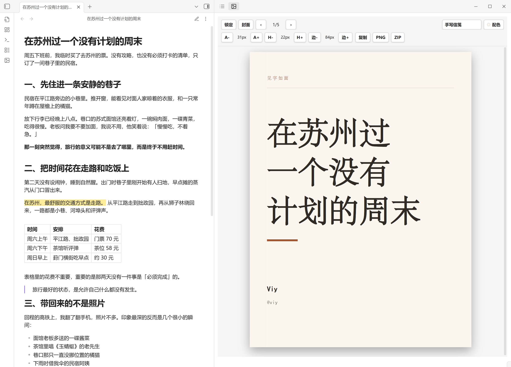
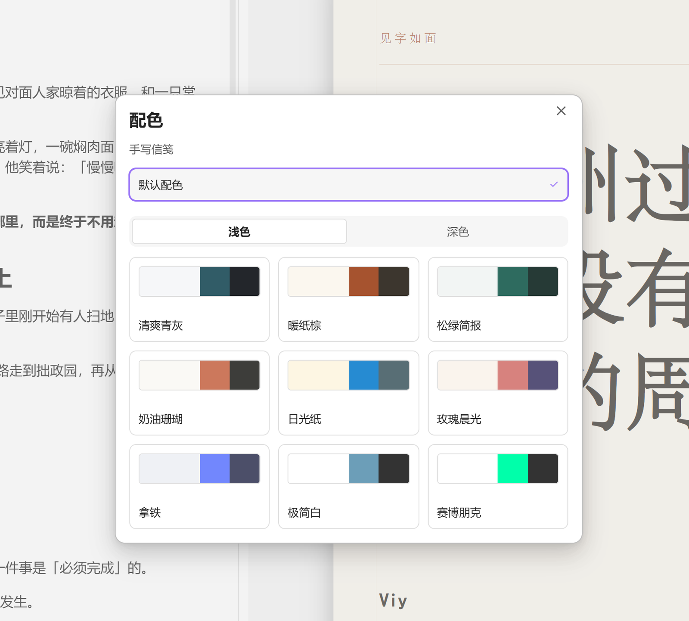
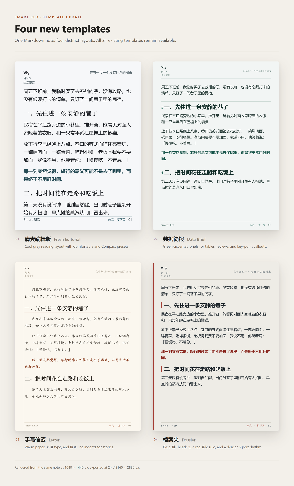
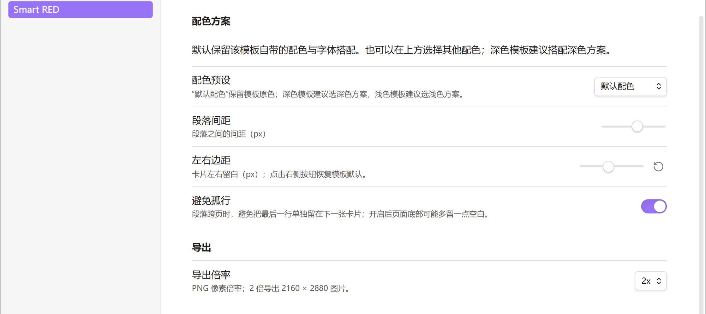
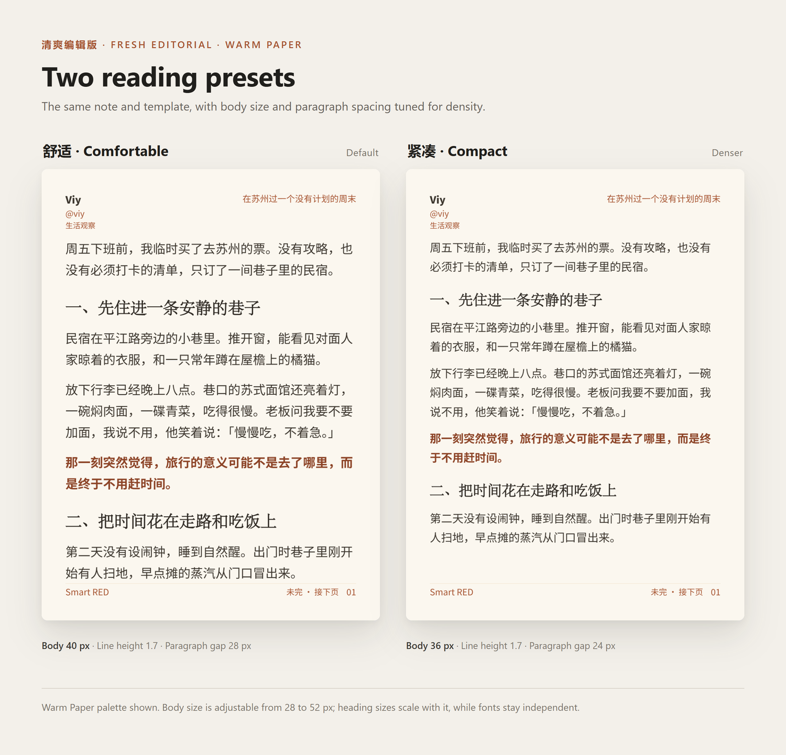

# Smart RED

   

**Smart RED** turns Obsidian Markdown notes into **Xiaohongshu (RED) image cards** at 1080 × 1440 pixels (3:4). Preview beside your note, choose from 25 templates, adjust typography and colors, then copy or export PNG images.

> 中文说明：[README.zh.md](./README.zh.md) · Release history: [CHANGELOG.md](./CHANGELOG.md)

Smart RED requires desktop Obsidian. It does not upload or publish your notes.



*Write in the note, preview the 3:4 card beside it, and export when the pagination looks right.*

## What's new in 0.3.1

- The palette picker now has clear light/dark category controls, color swatches, names, and selection marks. The default option stays at the top; narrow windows use two columns.
- Palette cards have enough height for their content instead of overflowing Obsidian's fixed-height buttons.
- Plugin unload no longer closes the preview leaf. Obsidian manages the view lifecycle and preserves its position in your workspace. This addresses the blocking automated-review finding in 0.3.0.



*The 0.3.1 palette picker: browse 浅色 (light) and 深色 (dark) categories, preview each palette, and keep the template default one click away.*

## What's new in 0.3.0

- Four new templates: 清爽编辑版 (Fresh Editorial), 数据简报 (Data Brief), 手写信笺 (Letter), and 档案夹 (Dossier). All 21 existing templates remain available.
- A palette picker with light and dark groups, color previews, and a template-default option.
- Side-padding controls and an optional paragraph widow guard, enabled by default.
- Comfortable and Compact reading presets for Fresh Editorial, with separate body and heading fonts.
- Chinese template names, settings, and toolbar labels.



*The four new templates, rendered from one travel note: 清爽编辑版, 数据简报, 手写信笺, and 档案夹. Cards are 1080 × 1440 px; exports are 2160 × 2880 px.*

## Install or update

### Obsidian Community plugins

In **Settings → Community plugins → Browse**, search for **Smart RED**, install it, and enable it. Existing users can use **Check for updates** in Community plugins and update Smart RED.

The community entry points to [Viy1204/smart-red-public](https://github.com/Viy1204/smart-red-public). Updates are distributed through this repository's GitHub Releases; an existing plugin does not need a new community submission for each release.

### Manual installation

1. Download `main.js`, `manifest.json`, and `styles.css` from the [latest release](https://github.com/Viy1204/smart-red-public/releases/latest).
2. Put the three files directly in `<vault>/.obsidian/plugins/smart-red/`.
3. Reload Obsidian and enable **Smart RED** under Community plugins.

When updating manually, keep your existing `data.json`: it stores your settings. Do not replace the entire plugin folder with an empty folder.

### Upgrading from 0.1.7 or the design test build

The production plugin ID remains `smart-red`. Existing production settings, including the selected template, profile, cover, font sizes, and custom colors, are retained. New installations start with Fresh Editorial and its Comfortable reading preset; upgrades keep their saved template.

The separately installed **Smart RED 排版测试版** uses the ID `smart-red-design-test`. Its settings remain separate and are not imported automatically. After installing the production version, select the same template and settings if desired, then disable the test plugin to avoid two preview panels. Keep a copy of the test plugin's `data.json` if you want to retain those settings.

## Use Smart RED

### Open the preview

Open a Markdown note, then click the Smart RED ribbon icon or run **Smart RED: 打开预览** from the command palette. Cards appear in the preview panel. If it is empty, make sure a Markdown note containing text is open.

### Toolbar

The interface uses Chinese labels. The controls below appear in the preview toolbar.

| Control | Action |
| --- | --- |
| 锁定 / 已锁定 | Freeze the current preview or resume live updates. |
| 封面 | Toggle the title cover; the active state is highlighted. |
| ‹ / › and page count | Move between cards, including the cover. |
| Template menu | Choose a template; the selection is saved. |
| 配色 | Open the palette picker. |
| 阅读 | Fresh Editorial only: choose 舒适 (Comfortable) or 紧凑 (Compact). |
| A− / A+ | Adjust body text size. |
| H− / H+ | Adjust header and footer text size. |
| 边− / 边+ | Adjust left and right padding in 2-pixel steps. |
| Font menu | Select a body font available on your system. |
| 复制 | Copy the current card as a PNG image. |
| PNG | Save the current card. |
| ZIP | Save every card as PNG files in a ZIP archive. |

### Write a note

```markdown
# Article title

## A section

Body text with **bold**, ==highlights==, ==**both**==, *italic*,
`inline code`, and [links](https://example.com).

- A point
- [ ] A task

> A quotation

---

This starts a new card.

| Item | Detail |
| --- | --- |
| A | Tables are rendered too. |


```

The first H1 supplies the document title; otherwise, Smart RED uses the file name. When a cover is enabled, its title can be hidden from the first body card to avoid duplication.

### Pagination and spacing

Smart RED waits for fonts and image dimensions, measures content in the selected template, and fills cards automatically. Headings stay together. Long paragraphs and code blocks can continue onto another card.

- A line containing only `---` forces a new card and is not drawn as a rule.
- One blank line separates paragraphs. Additional blank lines add vertical spacing, which is dropped at page boundaries.
- **避免孤行** (avoid widows) is enabled by default. It prevents a split paragraph from leaving only its final line on the next card, which can leave more space at the bottom of the preceding card. Turn it off to favor filling each card.
- **左右边距** (side padding) in settings accepts `0` for each template's default padding. The toolbar adjusts a custom padding value; cover titles reflow to the available width.
- Oversized tables and indivisible list items can still exceed a fixed card. Split those content blocks in the source note.



*Spacing, side padding, and the widow guard are applied to both the preview and the exported images.*

### Templates and palettes

| Template shown in the interface | ID | Suitable for |
| --- | --- | --- |
| 清爽编辑版 | `fresh-editorial` | Long reads, cool gray body cards, blue-gray title covers; default for new installations. |
| 数据简报 | `data-brief` | Analysis, reviews, tables, green accents, and key-point callouts. |
| 手写信笺 | `letter` | Stories and letters, warm paper, serif text, and first-line indents. |
| 档案夹 | `dossier` | Case studies, a red side rule, and file-style headers. |
| 编辑纸 / 黑白报告 / 新网格 | `editorial` / `monochrome` / `neo-grid` | Editorial, report, and grid layouts. |
| 暖调小志 / 深夜杂志 / 象牙随笔 | `warm-zine` / `noir-magazine` / `ivory-essay` | Personal writing, dark magazine pages, and restrained essays. |
| 红册 / 石板手记 / 珍珠杂志 / 墨色报告 | `red-ledger` / `slate-journal` / `pearl-magazine` / `ink-report` | Reviews, journals, narratives, and dense reports. |
| 暖阳文艺 / 备忘录 | `warm-sun` / `memo` | Warm serif pages and a memo layout. |
| Claude / MiniMax / xAI / Lovable / Notion / Figma / Apple / The Verge / Wired | `claude` / `minimax` / `xai` / `lovable` / `notion` / `figma` / `apple` / `the-verge` / `wired` | Nine brand-inspired layouts. |

Choose **配色** to preview and apply a color scheme. Switch between **浅色** (light) and **深色** (dark) to browse palettes; browsing does not apply a selection. Each card shows its colors and name, with a check on the current selection. The picker opens in the selected palette's category, or follows the template when using default/custom colors. **默认配色** (template default) stays at the top. Selecting a palette of the opposite tone shows a warning but remains possible. Switching templates resets a palette whose tone does not match the new template to the template default.

The four new templates use their own colors by default and can be recolored through the palette picker or the palette preset menu in settings. Their manual color controls are hidden. The other templates retain their saved custom colors and offer body, background, accent, bold, highlight, and H1–H3 overrides in settings. The bold and highlight reset buttons restore those individual colors to their defaults. Preview and export share these colors.

### Fresh Editorial reading controls

| Preset | Body size | Line height | Paragraph gap |
| --- | --- | --- | --- |
| 舒适 / Comfortable | 40 px | 1.7 | 28 px |
| 紧凑 / Compact | 36 px | 1.7 | 24 px |



*The same note at Comfortable and Compact, shown with the Warm Paper palette. Body size and paragraph gap change; line height and fonts stay independent.*

Sizes refer to the 1080 × 1440 canvas. Body size can be adjusted from 28 to 52 px; heading sizes scale with it. Header and footer text defaults to 28 px. Changing body size or paragraph spacing outside a preset shows **自定义** (custom); choosing a preset again resets those two values and keeps the fonts.

Fresh Editorial stores its reading settings separately from the other templates. Its body and heading fonts can be set independently in settings, using CSS font stacks. The toolbar font menu changes its body font. Chinese fonts are resolved from installed system fonts rather than downloaded; device fonts can change line breaks and page counts.

### Profile, cover, and export

Configure your avatar, nickname, handle, subtitle, footer, and their visibility in **Settings → Smart RED**. Cover settings control the title cover, author information, and duplicate first-heading removal.

Use **复制** to copy one card, **PNG** to save it, or **ZIP** for the entire note. The default export scale is 2×, producing 2160 × 2880 images. A higher export scale increases resolution without changing the layout.

## Supported content

Smart RED supports H1–H6, bold, highlights, italic, strikethrough, links and wikilink labels, inline code, lists, task lists, quotations, fenced code, images, and tables. Relative image paths are resolved from the current note; images that fail to load are skipped. Frontmatter, Obsidian callouts/embeds, Mermaid, and math are not rendered as their native Obsidian blocks.

## Troubleshooting

**Copy or PNG shows a failure, or the image is blank.** Reload the latest plugin build and try a short note with a built-in template. Copy also depends on your operating system's clipboard. Include the console error after `Smart RED: copy failed` or `Smart RED: export failed`, a minimal note, and Obsidian debug information when reporting a failure.

[Issue 11](https://github.com/Viy1204/smart-red-public/issues/11) tracks an environment-specific Copy/PNG failure reported on 0.1.7. Its cause has not been established; 0.3.0 does not claim to resolve it.

**A font looks different on another device.** Most CJK fonts use system fallbacks. Install the intended font or choose a font already available on both systems. The brand templates bundle subsets of Inter, Hanken Grotesk, Playfair Display, and Source Serif 4; see [LICENSE-FONTS](./LICENSE-FONTS).

**The page has more bottom space after updating.** The new widow guard can move a line to keep a paragraph ending together. Disable **避免孤行** if you prefer denser cards. The final card can remain short.


## Development and release

This public repository is the canonical home for development, issues, pull requests, and releases.

```bash
git clone https://github.com/Viy1204/smart-red-public
```

```bash
cd smart-red-public
```

```bash
bun install --frozen-lockfile
```

```bash
bun test
```

```bash
bun run build
```

Development watch mode is `bun run dev`. Production builds generate `main.js` and `styles.css`; edit `styles.css.base` and the template source rather than the generated CSS.

For a release, update `package.json`, `manifest.json`, and `versions.json`, update this documentation and [CHANGELOG.md](./CHANGELOG.md), and run the tests and build. Push the candidate branch and use **Review branch** on the Obsidian community management page; resolve blocking errors before merging into `main`. Create a tag exactly matching `manifest.version`, such as `0.3.1` without a `v` prefix, and publish a non-draft, non-prerelease GitHub Release with `main.js`, `manifest.json`, and `styles.css` as individual assets. Verify that the downloaded assets match the tested build, then confirm the new release's automated review has completed without blocking errors and the directory listing is available. No new community registration PR is needed for an ordinary version update.

The plugin uses TypeScript, esbuild, Bun test with happy-dom, `@cto.af/linebreak`, `html-to-image@1.11.11`, `html2canvas`, and `fflate`. Preview styles are isolated in Shadow DOM; export renders into off-screen light DOM. Pagination relies on measured DOM height; DOM mocks alone cannot verify actual page layout.

## License

[MIT](./LICENSE). Bundled font notices: [LICENSE-FONTS](./LICENSE-FONTS).
